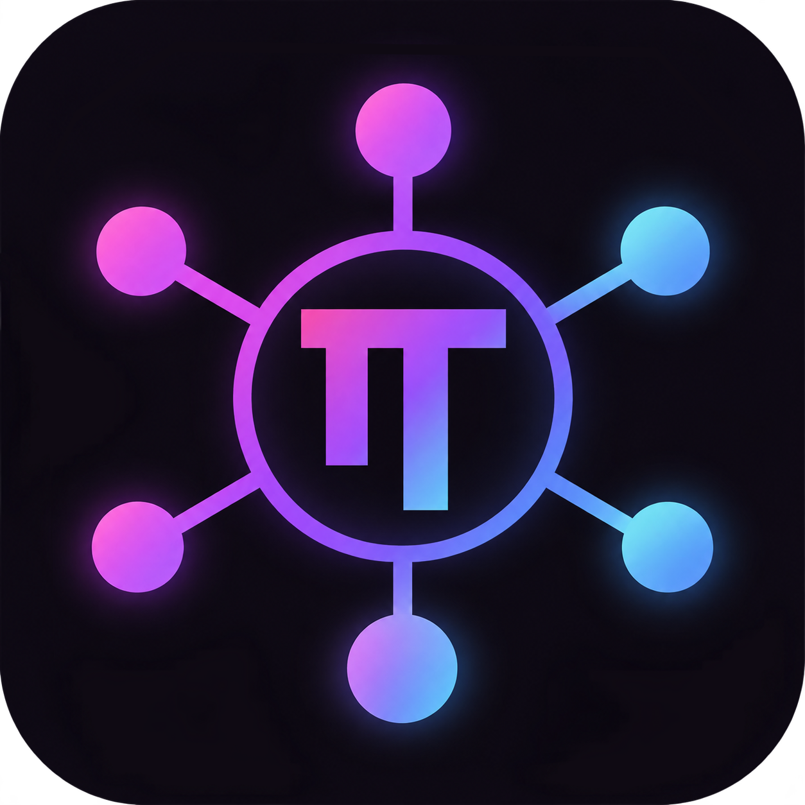
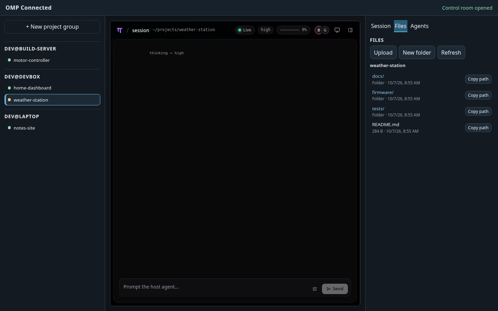
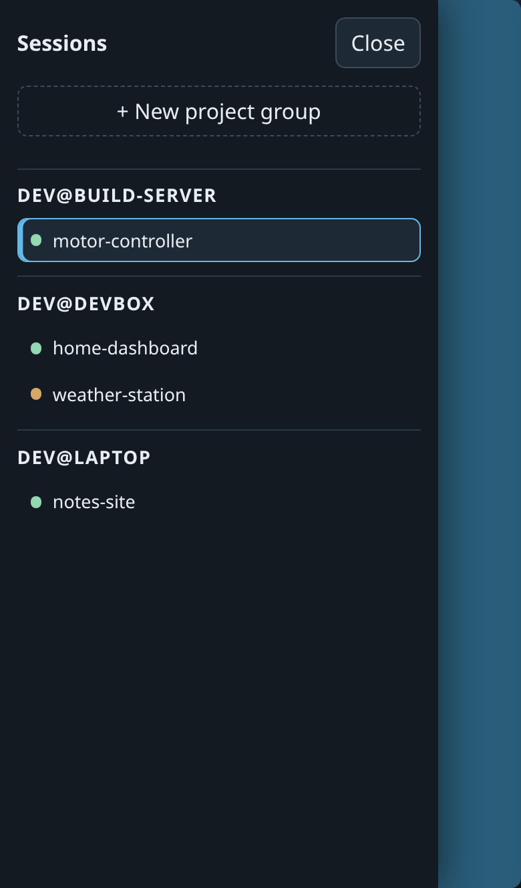
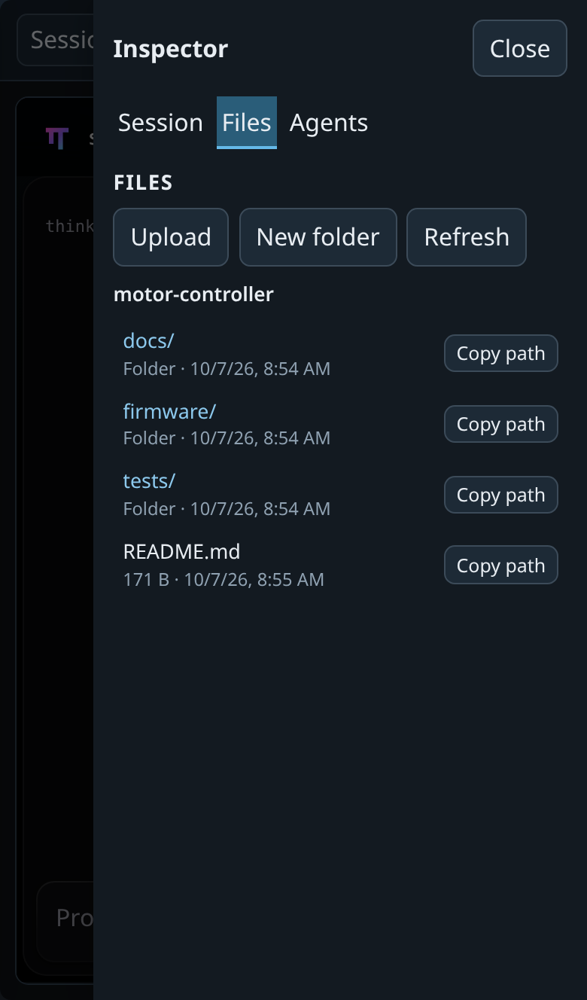

<p align="center">
  
</p>

# omp-connected

A self-hosted dashboard for all your [Oh My Pi](https://github.com/can1357/oh-my-pi) (omp) coding agent sessions, across every machine you run them on. Follow and drive any session from a browser or your phone, and let sessions message each other.

Each omp session started with `ompc` registers with a hub you run on one always-on host. The hub's dashboard lists every live session grouped by host; pick one and you get the session itself through omp's Collab: the conversation and tool calls as they happen, and a prompt box to steer the agent. Session traffic goes through a private relay on the hub, which only forwards encrypted frames.



<p align="center">
  
  &nbsp;&nbsp;
  
</p>

## Features

- **Every session in one place.** Live sessions from all your hosts, grouped by host and labelled with their `ompc` session name. Right-click a session (long-press on touch) and choose **Copy session name** to copy its qualified address, such as `session:user@hub-host`. Choose **Exit session** on a control-shared session to close OMP and its `ompc` tmux instance, after a confirmation prompt.
- **Shared session order.** Drag a session by its handle within a host or project section, or focus the handle and press ArrowUp or ArrowDown. The hub saves one session order for all dashboard tabs and devices; each section shows its sessions in that order. Newly discovered live sessions appear first; temporary host outages do not erase their saved positions.
- **Start or resume on a host.** Click the **+** icon beside a host heading to start a detached `ompc`, or pick past conversations from that host's newest-first history. Click a conversation to select it, Ctrl-click (Cmd-click on Mac) to toggle individual selections, or Shift-click to select a range. The popup excludes conversations already open. Desktop entries show the title and date on one line, with the path below. Hover truncated titles/paths to read them in full, or the date for the session UUID. Path and Name work like `cd <path>; ompc <name>`; Name is the optional suffix after the directory name. Selecting a past conversation prefills the path and any remembered suffix. Names are remembered locally on the host once its updated extension has seen them, older conversations without a saved name leave it blank. The host needs an updated extension in at least one running control-shared session.
  Use the resume button to resume each selected conversation with its own path and remembered name. If selected sessions need the same tmux label, the launcher assigns distinct suffixes. A label already used by a live session causes an error; close that session or retry with another name. Filtering does not clear the selection. If some launches fail, the dialog shows the errors and keeps only those sessions selected for retry. Click **New session** to clear the selection.
  Use **Browse folders** beside Path to open a folder tree, select a folder on the host or create a new one. Folder suggestions appear as you type. Browsing requires an updated extension with a control-shared session on the host; manual path entry remains available on older hosts.
- **Rewind or fork from a prompt.** In a writable browser session, right-click a user-authored prompt (long-press on touch) to rewind the idle host to before it, restoring the prompt text and images to the composer, or fork it into a separately named session. Actions are available only when the host is idle and no UI request or command suggestions are open. A fork is a new detached OMP process with its own session file, not a branch of the current conversation. This needs the forked OMP host and Collab guest. See [hub architecture](hub/ARCHITECTURE.md#collab-rewind-and-fork) for the flow.
- **Send to another host.** Right-click a control-shared session and choose **Send to host** to move the conversation (same UUID) to another configured host, optionally copying the project with rsync. Off by default; see [Send a session to another host](#send-a-session-to-another-host). This needs the forked OMP on both hosts.
- **Send later.** Hold the Send button for a moment to queue a prompt for later instead, either after a delay or at a time of day. The session itself holds the prompt, so it still goes out with the browser closed; a strip above the prompt box counts down to each one and lets you cancel it. Waiting prompts are dropped if the omp session exits.
- **Session panel.** The inspector shows the selected session's working directory, state, model, thinking level and context usage, and lets you search available models before switching, change the thinking level, compact the context or abort a turn.
- **Model roles panel.** View effective selectors, resolved models and assignment provenance for built-in and custom roles. Where supported, search eligible models, choose a thinking level and save an explicit global or project assignment, or reset to OMP's automatic and fallback behavior. View-shared sessions are read-only.
- **Agents tab.** The Agents tab, left of Roles in the inspector, lists the session's agent definitions (bundled, user, project and plugin) and, for each, how its model is chosen: the agent file's own `model`, a `task.agentModelOverrides` setting, or the session's model, then the role it expands through, the candidate selectors, the resolved model and thinking level. The role list shows which agents use each role, and the chips link between the two views. It is read-only and uses OMP's own resolver, so it matches what a spawned subagent gets. It lists the working directory of the selected session, so project agents differ between sessions.
- **Model dropdown ordering.** Session and role selectors group models by provider and show model names in descending numeric-aware order, so higher model versions appear first.
- **Files panel.** Browse the session's working directory, download files, preview images, create folders, and upload files (button or drag and drop, up to 256 MB each). Drop files in the upper part of the pane to upload to the current folder, or the lower part to upload to the host's temporary directory. After upload, the file path is copied to the clipboard. File access is confined to the working directory except for uploads to the host temporary directory; both controls and files need a session shared with control access.
- **Images in prompts.** Paste, drop or attach images in a session's prompt box; they're downscaled in the browser to fit a relay frame. This needs the forked Collab guest, see [Fork build](#fork-build-of-omp).
- **Slash commands.** A writable browser guest can type `/` to autocomplete the host's commands (builtins, skills, extension and custom commands) and run them on the host; the output comes back in a panel under the conversation. Commands that relocate the session or touch the host machine (`/move`, `/wt`, `/stats`, `/trace`, `/browser`, `/computer`, `/session delete`) are not offered. This needs the forked omp on the host and the forked guest in the hub. With stock omp the same text is sent to the agent as an ordinary prompt.
- **Prompt history.** Use ArrowUp/Down in the prompt box, or swipe up/down on touch, to recall earlier user prompts. Moving past the newest prompt restores your unsent draft. This needs the forked Collab guest.
- **Fast joins to long sessions.** The browser joins with the recent end of the conversation and loads earlier history on demand, instead of downloading the whole session first. This needs the forked omp on the host; with stock omp the guest downloads the full snapshot.
- **File viewer.** Clicking a text file in the Files tab opens a preview with a download button. Markdown and HTML switch between rendered and raw views. **Open in browser** opens the same viewer in a separate tab when the hub has a public origin. Markdown cannot run scripts. HTML can run scripts, load network resources and write to the clipboard in an isolated frame. Preview only HTML files you trust: scripts can change the preview, write to the clipboard and send network requests. The hub rejects cross-origin browser mutations, but this is not user authentication and non-browser clients can omit the Origin header. Static relative script, image, stylesheet, audio and video references resolve through the session file API; URLs with query strings, resources referenced from CSS, dynamic URLs and module imports are not rewritten and may not work. Closing the viewer stops the preview. Binary files and files over 10 MiB download directly.
- **Working or idle at a glance.** Each session in the dashboard's side list has a dot: pulsing amber while the agent is mid-turn, green when it is idle and waiting for input. It updates live; sessions running an older extension show no dot until restarted.
- **Terminal access.** For a control-shared `ompc` session, the Session tab's **Tools** section has an **Open terminal** button that opens an xterm.js window attached to the session's tmux server, showing the real omp TUI (for `/settings` and other dialogs the Collab view lacks). Sessions need to be restarted after updating the extension to advertise `terminal.v1`; sessions not started through `ompc` have no tmux and no button. It works on every host with no per-host configuration. The hub checks request origins against its public and allowed origins and checks the session's Collab control access, then issues random, short-lived tickets to the host over agent RPC. The hub has no dashboard-user authentication, so these checks do not identify a user. When a direct TLS URL is available, the browser tries it first; otherwise it uses the hub relay. If both direct and relay connections fail, the browser requests a new endpoint and tries the relay again. PTY output uses bounded queues and closes on overflow.
  The terminal toolbar provides one-shot Ctrl and Alt modifiers and an expandable F1–F12 row. **Split** opens a tmux pane beside the current pane on desktop or below it on mobile, independent of the tmux prefix. Pane layout changes are shared with other clients of the tmux session. The split button requires an updated extension and hub.
- **Phone friendly, installable app.** The dashboard has a mobile layout with slide-out session and inspector drawers, and installs as an app (PWA) from Chrome on Android or desktop. When the hub can't be reached, the app shows an offline page instead of a browser error. See [Installing the dashboard as an app](#installing-the-dashboard-as-an-app).
- **Embeddable single-session link.** Right-click a control-shared session and choose **Copy share link** to get a `/s/` URL that shows just that session's full Collab guest, edge to edge, so it can sit in an `<iframe>` on another page served from the hub. The link holds no secret: it names the session by instance id plus its conversation id, directory and `ompc` label, and the page resolves it to the live room on every load. If the omp process has restarted it finds the same conversation or label again, and if nothing is running it starts the session (once per page load, or when you press **Start session**). A session that ends while the page is open is not restarted on its own. Anyone who can reach the hub can open the link with control access, same as the dashboard. See [Embedding a Collab session](docs/embedded_chat.md) for iframe and `postMessage` guidance.
- **Persistent sessions.** `ompc` runs each omp session in its own tmux server, so it survives disconnects and you can reattach from any terminal. A partial name brings up a picker of matching live sessions.
- **Agent-to-agent messaging.** Sessions can list each other, exchange messages and broadcast to teams through the hub.
- **Self-hosted.** One Bun server on your own network (Tailscale works well) with a shared registration token; nothing goes through a third party.

The repo has two parts:

| Component | Path | What it does |
|---|---|---|
| **Extension** | `extension/` | OMP plugin (`omp-connected`) plus the `ompc` launcher. Registers each session with the hub, handles Collab discovery, provides the agent-messaging tools |
| **Hub** | `hub/` | Always-on Bun server: dashboard, agent registry, Collab link broker and private relay |

## Prerequisites

- [OMP](https://github.com/can1357/oh-my-pi) (the official CLI), every host. Either the standalone binary or the Bun install works. Fast joins to long sessions, slash commands, image prompts, prompt history, rewind/fork and send to host additionally need a forked build, see [Fork build](#fork-build-of-omp); everything else works with stock OMP.
- [tmux](https://github.com/tmux/tmux) 3.5 or newer (session persistence for `ompc`), every host. Older tmux works, without csi-u modified keys such as Shift+Enter (3.5+) or clipboard/image passthrough (3.3+).
- [Bun](https://bun.sh) (runtime for the hub server), hub host only.

```sh
# Install OMP (official installer)
curl -fsSL https://omp.sh/install | sh

# Install Bun (hub host)
curl -fsSL https://bun.sh/install | bash
```

## Install

### 1. Clone

```sh
git clone https://github.com/andrewleech/omp-connected.git ~/omp-connected
```

Clone to `~/omp-connected`: the systemd units in `hub/deploy/` expect the checkout there.

### 2. Run the installer

```sh
~/omp-connected/install.sh
```

It checks OMP and tmux, links `extension/` as an OMP plugin, and symlinks
`ompc`, `ompc-send` and `ompc-transfer-helper` into `~/.local/bin` (override
with `OMPC_BIN_DIR`), which most distros put on `PATH` at login. It then
reports whether the hub connection (step 4) and Collab settings are
configured. It's idempotent; re-run it after updating the checkout.

### 3. Deploy the hub

Do this on one always-on host only. Every other host is a client of this hub;
see [Adding hosts to the fleet](#adding-hosts-to-the-fleet).

On the hub host, fetch the pinned upstream omp source the dashboard's Collab guest is built from, then install dependencies and build the dashboard:

```sh
cd ~/omp-connected
git submodule update --init --depth 1 hub/vendor/collab-web
cd hub
bun install
bun run build
```

Generate a shared secret for agent registration:

```sh
openssl rand -hex 32
```

Create the environment file:

```sh
mkdir -p ~/.config/omp-hub
cat > ~/.config/omp-hub/omp-hub.env << 'EOF'
OMP_HUB_PORT=4816
OMP_HUB_HOST=127.0.0.1
OMP_HUB_HOST_TOKEN=<paste-your-secret-here>

# TLS (required for non-localhost access)
# OMP_HUB_TLS_CERT=/path/to/cert.pem
# OMP_HUB_TLS_KEY=/path/to/key.pem

# Dashboard session groups and order are saved here (default: ~/.local/state/omp-hub)
# OMP_HUB_STATE_DIR=/path/to/state
EOF
```

**Test it manually first:**

```sh
cd ~/omp-connected/hub
set -a && . ~/.config/omp-hub/omp-hub.env && set +a
bun run start
```

Then visit `https://<host>:<port>/health`.

**Install as a systemd user service:**

```sh
cp ~/omp-connected/hub/deploy/omp-hub.service ~/.config/systemd/user/
systemctl --user daemon-reload
systemctl --user enable --now omp-hub.service
```

### 4. Configure OMP sessions

Every OMP session needs two environment variables to register with the hub.
`ompc` sources them from `~/.config/omp-connected/omp-host.env` (override the
path with `OMP_HOST_ENV`) on every launch:

```sh
mkdir -p ~/.config/omp-connected
cat > ~/.config/omp-connected/omp-host.env << 'EOF'
OMP_HUB_URL=https://<your-hub-host>:<port>
OMP_HUB_HOST_TOKEN=<same-secret-as-hub>
EOF
chmod 600 ~/.config/omp-connected/omp-host.env
```

Sessions started with plain `omp` rather than `ompc` don't read that file;
export the same two variables from your shell profile instead.

The extension is a graceful no-op when either is unset.

Registration also needs Collab running in the session. The extension gets
the session's identity from its Collab instance ID, so a session without a
Collab host never registers and never appears on the dashboard. Set
`collab.relayUrl` and `collab.autoStart` as described in
[OMP settings](#omp-settings).

### 5. Use the session launcher

`ompc` is the everyday entry point. It wraps each OMP session in its own
tmux server for persistence and reattach:

```sh
# Start or reattach to a session (named after the current directory)
ompc

# With a suffix
ompc feature-branch

# Detached (for background/agent-spawned sessions)
ompc -d worker
```

When other live sessions extend the requested name (bare `ompc` matches
`<dir>` and `<dir>.*`; `ompc feat` matches `<dir>.feat*`), an interactive
`ompc` lists them with attached/idle state: move with ↑/↓ (or j/k), Enter
selects, q/Esc quits. The highlighted default is the exact name, attaching
to it or creating it if it isn't running. A lone exact match or no match
skips the menu. So does `-d`, or running without a terminal.

### 6. Open the dashboard

Browse to `https://<hub-host>:4816`. Sessions show up as soon as `ompc` starts them, grouped by host; click one to open it.

#### Installing the dashboard as an app

The dashboard is a PWA. In Chrome on Android use **Add to Home screen**, then **Install**; desktop Chrome shows an install icon in the address bar. It needs HTTPS with a valid certificate (see [TLS](#tls)), and on Android the phone needs internet access while installing so Google can build the app package.

Android registers an installed web app by host, not host and port. If another web app on the hub host is already installed, Chrome treats the dashboard as installed too; give the dashboard its own hostname in that case. [hub/README.md](hub/README.md#installing-as-an-app-pwa) shows how, using a second Tailscale node.

### Updating

```sh
cd ~/omp-connected && git pull && ./install.sh   # extension + ompc
omp update                                       # OMP itself

# hub host only: rebuild the dashboard and restart the hub
git submodule update --init --depth 1 hub/vendor/collab-web
cd hub && bun install && bun run build && systemctl --user restart omp-hub.service
```

Running sessions keep the old extension code until OMP restarts inside them.

## Fork build of OMP

Fast joins, slash commands, image prompts, prompt history, rewind/fork and send to host depend on changes that upstream OMP doesn't have yet. They live on branches of [andrewleech/oh-my-pi](https://github.com/andrewleech/oh-my-pi), merged into `ompc-fleet` (a tagged upstream release plus the fleet feature branches). Two things are built from it:

- **A forked `omp` binary on every host.** It sits next to your normal OMP and is used only by `ompc`; plain `omp`, and therefore `omp update`, are untouched.
- **The Collab guest in the hub**, on the hub host.

For a Linux x64 fleet, build the baseline target with Bun and git. Other platforms need their own `CROSS_TARGET` and matching native addon:

```sh
git clone -b ompc-fleet https://github.com/andrewleech/oh-my-pi.git ~/src/oh-my-pi
cd ~/src/oh-my-pi
bun install
# Prebuilt native addons from the newest published release at or below this branch's base
# (package.json says which; swap linux-x64 for your platform, e.g. darwin-arm64)
d=$(mktemp -d) && (cd "$d" && npm pack -q @oh-my-pi/pi-natives-linux-x64@<release> && tar xzf *.tgz) &&
  cp "$d"/package/*.node packages/natives/native/ && rm -rf "$d"
CROSS_TARGET=linux-x64 bun --cwd=packages/coding-agent run build
packages/coding-agent/dist/omp-linux-x64 --smoke-test
```

Compiling the natives locally also works but links against your machine's glibc, so a binary built on a new distro may not load on an older host.

On each host, install the binary and tell `ompc` to use it:

```sh
install -m755 packages/coding-agent/dist/omp-linux-x64 ~/.local/share/omp-connected/omp.new
mv ~/.local/share/omp-connected/omp.new ~/.local/share/omp-connected/omp
echo 'OMP_BIN=$HOME/.local/share/omp-connected/omp' >> ~/.config/omp-connected/omp-host.env
```

On the hub host, build the guest from the same checkout and restart the hub:

```sh
cd ~/omp-connected/hub
COLLAB_WEB_SRC=~/src/oh-my-pi/packages/collab-web bun run build
systemctl --user restart omp-hub.service
```

Without `COLLAB_WEB_SRC` the hub builds the older guest pinned in `hub/vendor/collab-web` (upstream OMP v15.5.9), which has none of the above.

### Refreshing onto a tagged upstream release

A forked binary doesn't update itself. Rebuild the integration with [mbm](https://github.com/andrewleech/micropython-branch-manager), keeping the feature branches separate so they can still become independent upstream PRs. Use a clean checkout, or make a separate refresh checkout if the existing one has active work. Never remove another session's worktrees or reset a checkout with uncommitted changes.

For a separate checkout, install mbm and fetch the upstream tags:

```sh
uv tool install micropython-branch-manager
git clone -b ompc-fleet https://github.com/andrewleech/oh-my-pi.git ~/src/oh-my-pi-release
cd ~/src/oh-my-pi-release
git remote add upstream https://github.com/can1357/oh-my-pi.git
git fetch upstream --tags
tag=$(gh api repos/can1357/oh-my-pi/releases/latest --jq .tag_name)
for branch in collab-tail-snapshot collab-web-image-attach collab-guest-commands \
  collab-relay-heartbeat collab-web-viewport-cap collab-web-rail-closed \
  collab-guest-leaf collab-guest-rewind collab-guest-prompt-history; do
  git branch --track "$branch" "origin/$branch"
done
```

Keep the branch list in an untracked `~/omp-connected/.omp/mbm.toml`. Its path is relative to that config file. Point it at the refresh checkout and set `target` to the selected tag (`v18.8.4` in this example), not `upstream/main`:

```toml
[[submodules]]
path = "../../src/oh-my-pi-release"
integration_branch = "ompc-fleet"
target = "v18.8.4"
update_feature_branches = false
branches = [
  { name = "collab-tail-snapshot", title = "Tail-first Collab snapshots", author = "andrewleech", pr_url = "https://github.com/can1357/oh-my-pi/pull/13389", pr_number = 13389 },
  { name = "collab-web-image-attach", title = "Guest image attachments", author = "andrewleech" },
  { name = "collab-guest-commands", title = "Guest slash commands", author = "andrewleech" },
  { name = "collab-relay-heartbeat", title = "Relay heartbeat recovery", author = "andrewleech" },
  { name = "collab-web-viewport-cap", title = "Embedded guest viewport height", author = "andrewleech" },
  { name = "collab-web-rail-closed", title = "Keep the agents rail closed", author = "andrewleech" },
  { name = "collab-guest-leaf", title = "Host-authoritative active branch sync", author = "andrewleech" },
  { name = "collab-guest-rewind", title = "Guest rewind and separate-session fork", author = "andrewleech" },
  { name = "collab-guest-prompt-history", title = "Composer prompt history", author = "andrewleech" },
]
```

Keep this list aligned with the fleet's feature branches. PR entries are fetched from GitHub's `pull/N/head`; fork-only entries use the local branches, which the commands above create from `origin`. `update_feature_branches = false` leaves their refs and published PRs unchanged. Remove a merged feature once its changes are in the selected release. Warnings about no PR for a fork-only branch are expected.

Preview the target/branch list, then rebuild:

```sh
cfg=$HOME/omp-connected/.omp/mbm.toml
mbm rebase --config "$cfg" --target "$tag" --dry-run
mbm rebase --config "$cfg" --target "$tag"
```

Conflicts stop the rebuild in the refresh checkout. Resolve and stage the affected files, then run `git rebase --continue` for a rebase conflict or `git commit` for a merge conflict. Continue mbm with `mbm rebase --config "$cfg" --resume`. Keep changes to feature branches or merge conflict resolutions, never add ordinary commits directly to the machine-managed integration branch.

If a feature needs release compatibility fixes, commit them on its own branch/worktree. For unpublished fixes, use a temporary config that points at those local branches without PR metadata, verify the resulting fleet, then publish the feature branches and restore the PR entries. Otherwise mbm fetches the published PR head and misses the local fixes.

The result is `ompc-fleet_update`. Build and test there before publishing, using the native addon from the same release tag:

```sh
bun install --frozen-lockfile
d=$(mktemp -d)
(cd "$d" && npm pack -q "@oh-my-pi/pi-natives-linux-x64@${tag#v}" && tar xzf ./*.tgz)
mkdir -p packages/natives/native
cp "$d"/package/*.node packages/natives/native/
rm -rf "$d"
bun --cwd=packages/coding-agent test test/collab --timeout 60000
bun --cwd=packages/coding-agent run check:types
bun --cwd=packages/collab-web run check
bun --cwd=packages/collab-web test
CROSS_TARGET=linux-x64 bun --cwd=packages/coding-agent run build
bun --cwd=packages/collab-web run build
packages/coding-agent/dist/omp-linux-x64 --version
packages/coding-agent/dist/omp-linux-x64 --smoke-test
git push --force-with-lease origin ompc-fleet_update:ompc-fleet
```

This only builds and publishes the fork, it does not deploy it. The binary is in `packages/coding-agent/dist/omp-linux-x64` and the guest is in `packages/collab-web/dist`. Cross-target builds do not replace `dist/omp`, so use the named artifact rather than a binary left by an earlier build. Do not run the hub's build against its live `dist/webui` during verification, it replaces served assets. Install the binary and rebuild the hub guest from this same refresh checkout using the deployment steps above, then restart the hub. Running OMP sessions keep their old binary/extension until restarted. Once the feature changes are merged and released upstream, remove `OMP_BIN` and go back to stock OMP.

## Adding hosts to the fleet

One host runs the hub; every other host runs only the extension and joins
as a client. A client host needs no hub deployment and no TLS certificate.

On each additional host:

1. **Network.** Make sure the host can reach the hub port (default `4816`)
   and the relay port (default `7466`) on the hub host. On Tailscale, join the
   same tailnet and check that your ACLs allow both ports:

   ```sh
   curl -s https://<hub-host>:4816/health
   ```

2. **Extension.** Install the [prerequisites](#prerequisites), clone the repo,
   and run `install.sh` ([Install steps 1–2](#1-clone)). To use the
   [forked OMP](#fork-build-of-omp), install its binary here too.

3. **Hub credentials.** Create `~/.config/omp-connected/omp-host.env` with the
   hub URL and the same `OMP_HUB_HOST_TOKEN` the hub uses
   ([step 4](#4-configure-omp-sessions)). The simplest way is to copy the file
   from a host that already works and `chmod 600` it.

4. **Collab.** Point Collab at the hub's relay and turn on auto-start. This
   is required: without it the session never registers.

   ```sh
   omp config set collab.relayUrl wss://<hub-host>:7466
   omp config set collab.autoStart control
   omp config set collab.displayName <this-host>
   ```

5. **Launch.** Re-run `install.sh` to confirm both checks report `ok`, then
   start sessions with `ompc`. On first launch, OMP's setup wizard asks you to
   sign in to a model provider; the session registers with the hub even
   before that.

The hub's `OMP_HUB_RELAY_ALLOWED_ORIGINS` needs no change for new hosts: it
lists browser origins, and the only browser pages are the hub's own dashboard
(at `https://<hub-host>:4816` and, if set up, its own app hostname; see
[hub/README.md](hub/README.md#installing-as-an-app-pwa)).

### Identity

Each session registers as `<user>@<hostname>:<collab-instance-id>`, taken from
`os.userInfo()` and `os.hostname()`. Hostnames must therefore be unique across
the fleet. Host IDs starting with `operator@` are reserved for the dashboard
and are rejected.

### Verify

```sh
curl -s https://<hub-host>:4816/api/hosts/
# [{"hostId":"you@hub-host"},{"hostId":"you@new-host"}]
```

Inside a session, `ompc_identity` returns the registered ID. If the host
doesn't appear, check the OMP log:

- `registration attempt failed`: hub unreachable or token mismatch. The
  extension retries with backoff (1–30s).
- `could not load omp's Collab CLI module`: the installed OMP predates
  `omp collab list --json`; run `omp update`.
- `could not discover this session's Collab instanceId`: Collab isn't
  running in the session (the Collab step above).

## Collab relay

The hub process also runs a private Collab relay that routes encrypted
session traffic between hosts and browser/terminal guests. It listens on its
own port, shares the hub's bind address and TLS certificate, and starts when
`OMP_HUB_RELAY_PORT` is set in `omp-hub.env`:

```sh
OMP_HUB_RELAY_PORT=7466
# Browser origins allowed to open relay WebSockets (comma-separated)
OMP_HUB_RELAY_ALLOWED_ORIGINS=https://<hub-host>:4816
```

Configure OMP to use your relay:

```
# In OMP settings
collab.relayUrl = wss://<your-relay-host>:7466
```

## OMP settings

| Setting | Value | Purpose |
|---|---|---|
| `collab.relayUrl` | `wss://<relay-host>:7466` | Your private relay |
| `collab.autoStart` | `control` | Auto-host a Collab room for every session |
| `collab.displayName` | Your name | Shown to Collab guests |

`collab.autoStart: control` creates bearer capability links that permit
prompting and interruption. Enable only after your hub and relay are
access-controlled.

## Agent messaging

Once two sessions are registered with the same hub, they can exchange messages:

| Tool | Purpose |
|---|---|
| `ompc_identity` | Show this session's agent identity |
| `ompc_list_agents` | List all registered agents |
| `ompc_send_message` | Send a message to another agent |
| `ompc_send_team` | Broadcast to a team |
| `ompc_join_team` / `ompc_leave_team` | Manage team membership |
| `ompc_mailbox` | Fetch recent messages |
| `ompc_events` | Query hub events |

## Send a session to another host

**Send to host** moves one conversation to another configured host and resumes it there with the same conversation UUID. The source OMP process stops, the journal (with nested subagent transcripts, artifacts and referenced image blobs) is packed and copied over ssh, and a detached `ompc` session resumes it at the same path relative to the destination's home directory. The project directory can be copied with rsync. Source files stay in place with a departure marker appended, so resuming the source copy later forks it to a new UUID. Processes, live subagents, tool sessions, terminal state, provider credentials and hardware connections do not move.

### Enable

The feature is off by default. On every host you send from, create `${XDG_CONFIG_HOME:-~/.config}/omp-connected/transfer.json`:

```json
{
  "enabled": true,
  "destinations": {
    "worker": {
      "hostId": "user@worker-host",
      "ssh": { "target": "user@worker-host", "port": 22, "identityFile": "~/.ssh/id_ed25519" },
      "helperPath": ".local/bin/ompc-transfer-helper",
      "allowedRoots": ["~"],
      "protectedPaths": ["~/.ssh", "~/.omp", "~/.config", "~/.local/state"]
    }
  }
}
```

- Destination names match `[A-Za-z0-9][A-Za-z0-9_.-]{0,63}`. `hostId` is a dashboard label only and is never used as an ssh target.
- `ssh.target` is `[user@]host`; `port` and `identityFile` are optional. `helperPath` (default shown) is the single command run over ssh, relative to the ssh login directory or absolute. It must point at where `install.sh` linked `ompc-transfer-helper` on the destination.
- `allowedRoots` (default `["~"]`): the destination project must be strictly beneath one. `protectedPaths` always include the four defaults shown; the destination project cannot be inside, equal to or above a protected path, the home directory or the filesystem root. Entries are absolute or start with `~/`, resolved against the destination's home.
- Unknown fields or invalid values turn the feature off and the extension logs the reason. Sessions advertise the feature when they start, so restart running sessions after enabling it.

### Requirements

- Both hosts: omp-connected installed with `install.sh` (the source needs `ompc-send`; the destination needs `ompc` and `ompc-transfer-helper`) and `rsync`.
- Both hosts: the [fork build of OMP](#fork-build-of-omp) with the `session-send-to-host` branch. Transfer calls `omp session pack`, `unpack`, `moved`, `reserve`, `release`, `reservation`, `locate` and `lease`. While a transfer holds a session, no other resume of it works on either host, and implicit auto-resume starts a new session instead of the reserved one. A running source session also refuses new user input from the moment the transfer starts (prompts, steers, follow-ups, `/retry`, `--restore` and user-attributed messages sent by extensions); agent-originated input such as IRC wakes and background job results is not blocked. Stock OMP has none of this.
- Key-based ssh from the source to the destination, with the destination's host key already in `known_hosts`. Transfers run ssh with `BatchMode=yes`, `StrictHostKeyChecking=yes` and no agent forwarding. The destination needs no transfer config and no ssh access to the source.
- For the dashboard, the hub's public origin must be reachable from the source host: the detached worker reports progress to it.

### From the dashboard

1. Right-click the session and choose **Send to host**. The item needs control access and a session that advertises transfer, and is disabled while the agent is busy. A session with queued messages, background jobs, scheduled prompts or an unanswered question refuses to stop.
2. Pick a destination. The dialog shows the source and destination project paths, UUID, title, launcher name, nested history count, archive size, warnings and blockers.
3. If the destination project does not exist it is created from the source. If it exists, a confirmation box offers:
   - **Update project with rsync**: adds and replaces files; files only present on the destination are kept (no `--delete`). A change preview is shown first.
   - **Leave project untouched; transfer session only** (default): only session data moves. The destination directory must already be usable.
   - **Cancel**: nothing changes on either host.
4. If the archive lacks image blobs or points at paths outside the packed tree, the dialog requires an explicit acceptance before sending.
5. After **Send**, the dialog shows progress and how long the source session has been unavailable. Cancel before publication removes staged data; during publication it only requests a stop at the next recorded boundary; after launch it does not undo anything. When the destination session registers, the dashboard selects it and moves the source's custom group membership to it. On failure the dialog shows the recovery actions that fit the state: **Resume transfer**, **Retry launch**, **Roll back source**, **Restore project** and **Clean up**. If the worker stops reporting, **Abandon** closes the operation on the hub, right away when the worker never reported and otherwise after the operation has been unchanged for 15 minutes. Abandon changes nothing on either host, so the source session may still need `ompc-send recover`. Closing the browser does not cancel the transfer.

The project copy includes hidden files, `.git` and uncommitted work. Only `.DS_Store` and `Thumbs.db` are excluded; `.gitignore` is not used. Symlinks are not followed, devices and sockets are skipped, and ownership and setuid bits are not copied. The plan warns about symlinks that leave the tree, absolute symlinks, external gitdirs, submodules and files that look like secrets. Project-local secrets travel with the copied files; credentials outside the project do not. A non-empty destination directory where the source has a file or symlink, or a source path under a destination symlink, is a conflict that blocks the update until you resolve it by hand and plan again. Another process using the destination project also blocks an update.

### From the command line

```sh
ompc send-to-host <sessionId> <destination> [--update-project|--session-only] [--yes] [--accept-incomplete] [--destination-path <path>]
```

The session must not be running; a running session is refused with exit code 75 and a pointer to the dashboard. The session is looked up from the current directory. The command prints the plan and asks for confirmation unless `--yes` is given (without a terminal, `--yes` is required). `--update-project` or `--session-only` chooses the mode for an existing destination project; without either, a missing destination project is created and an existing one is left untouched. `--destination-path` (absolute or `~/...`) is needed for a project outside the home directory. `--accept-incomplete` is needed when the plan reports missing blobs or outside references. The command runs the transfer in the foreground without the hub.

### Recovery

Each host journals its side of an operation under `${XDG_STATE_HOME:-~/.local/state}/omp-connected/transfers/`. On the source host:

```sh
ompc-send status --operation <id> [--remote]
ompc-send recover --operation <id> --action <resume|retry-launch|rollback-source|restore-project|cleanup>
```

`status` prints the journal record, worker progress and source reservation as JSON; `--remote` also asks the destination. `resume` continues a failed operation that has not yet departed the source, for example after a dropped connection or a failed copy. `retry-launch` resumes after the source departed and never starts a second destination session once the launch was consumed; it also repeats a source release that failed after the destination arrived. `rollback-source` cancels the destination launch first and releases the source only then, and removes the session copy that the transfer created on the destination; it is refused once the destination started and stays blocked while the destination is unreachable. `restore-project` undoes an update, leaving files edited since the update alone; afterwards `resume` and `retry-launch` are refused, so roll the source back. `cleanup` removes staging on both hosts and keeps project backups. The source session is released before an operation ends as completed or rolled back. If that release fails, the operation stays open and repeating `retry-launch` or `rollback-source` retries it. After a failure the worker waits up to 24 hours for the dashboard's recovery requests; `ompc-send recover` works at any time. Dashboard operation IDs are the UUIDs listed by `GET /api/transfers`. The hub drops finished operations from that list 14 days after their last update.

### Limits

- The destination project path is the source path relative to home. The dashboard has no override; use `--destination-path` for other paths.
- For an existing project the session is imported before the project is touched, so a diverged or older destination copy of the session is refused before any project write. A destination that already holds a copy of the session blocks planning; remove or reconcile the copy first.
- A new or updated project is staged under the destination's `${XDG_STATE_HOME:-~/.local/state}/omp-connected/transfers/` and moved into place, so that directory and the destination project must be on one filesystem. Planning reports a blocker when they are not. A session-only transfer is not affected.
- Reservations never expire. A session reserved by an operation cannot be resumed on either host until the operation completes or is rolled back.
- The hub's REST API has no user authentication. Anyone who can reach the dashboard with control access to a session can start a transfer to any destination in that host's `transfer.json`. Operation tokens only scope the worker to one operation. Enable the feature only on a trusted network.
- The destination runs the copied project's configuration and extensions. Dependencies may need rebuilding on a different architecture.
- Nothing installs OMP, ssh keys or credentials on the destination. Messages addressed to the old agent are not forwarded. To return a session, send it back with a new transfer.

## TLS

Non-localhost deployments require TLS. If you're on a Tailscale network:

```sh
mkdir -p ~/.config/omp-hub/certs
tailscale cert --cert-file ~/.config/omp-hub/certs/cert.pem \
               --key-file ~/.config/omp-hub/certs/key.pem \
               $(tailscale cert)
```

On the hub host, set `OMP_HUB_TLS_CERT` and `OMP_HUB_TLS_KEY` in
`~/.config/omp-hub/omp-hub.env` (client hosts need no certificate), then use
the cert renewal timer for automated rotation:

```sh
cp ~/omp-connected/hub/deploy/omp-hub-cert-renew.{service,timer} ~/.config/systemd/user/
systemctl --user enable --now omp-hub-cert-renew.timer
```

## Development

```sh
cd ~/omp-connected/hub
bun install
bun run test                      # unit tests
bun run test:e2e                  # Playwright browser tests
bun run build                     # rebuild dashboard + Collab guest
```

## Architecture

See [hub/ARCHITECTURE.md](hub/ARCHITECTURE.md) for the wire protocol,
security model, module layout, terminal relay and direct route, and Collab
rewind/fork flow. See [extension/ARCHITECTURE.md](extension/ARCHITECTURE.md)
for registration, terminal host behavior, Collab handling, and how detached
fork sessions are launched.

## Security model

- **Shared-secret registration.** A single fleet-wide token
  (`OMP_HUB_HOST_TOKEN`) gates agent registration. It authenticates "some
  session in the fleet," not a specific identity; the extension's claimed
  `hostId`/`instanceId` is accepted at face value.
- **Capability URLs.** Collab links are short-TTL bearer capabilities. The room
  key lives only in the URL fragment (never sent to a server in an HTTP
  request). The hub never logs the links it brokers.
- **Terminal capabilities.** The hub creates a random terminal capability for each request and sends it to the extension over the existing agent connection. It is not an HMAC signed with `OMP_HUB_HOST_TOKEN`. Same-origin checks and the Collab control check do not authenticate a dashboard user; the hub has no dashboard-user authentication.
- **Send to host.** Any dashboard client with control access to a session can start an enabled transfer; the dashboard does not authenticate a person. The worker holds a short-lived (10 minute) token for one operation and renews it with a private renewal secret until the operation finishes. The hub stores only SHA-256 verifiers of both. Ssh uses batch authentication with strict host key checking, and the only remote command is the configured helper.
- **The relay is content-blind.** It forwards encrypted binary frames between
  host and guests. It cannot read session content.

## License

[MIT](LICENSE)
