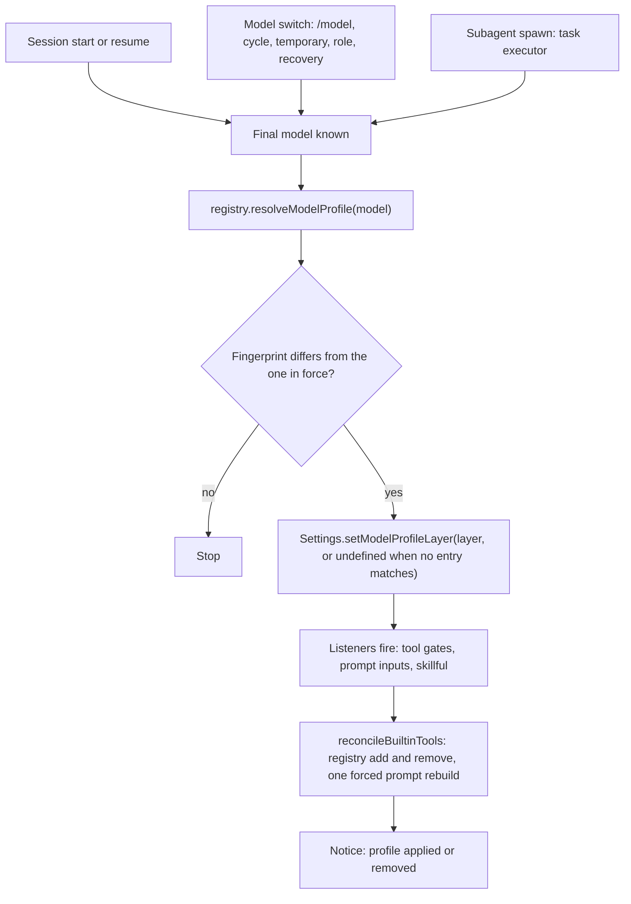
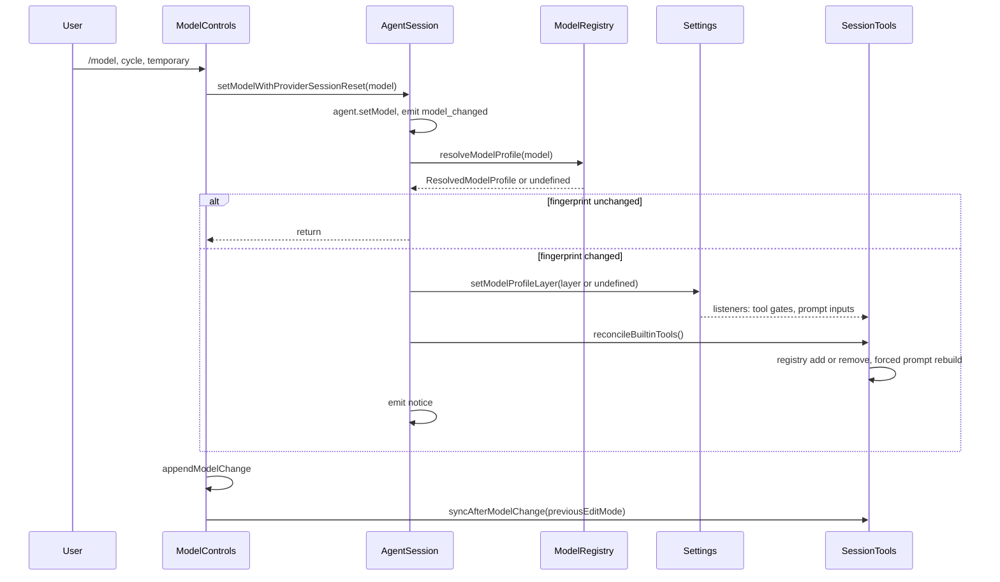

# Design: per-model profiles that reduce initial context

Date: 2026-10-19
Source: `v18.10.4` (687892d104, 2026-10-13)
Status: superseded by `20261020_capability_selector_design.md`; kept for the measurements. No code written

All line anchors are at `v18.10.4` and relative to `packages/coding-agent/src` unless a path says otherwise. `upstream/main` (9d5d4ac5b5, 2026-10-18) still contains the symbols this document names (spot-checked: `syncAfterModelChange`, `reconcileModelDependentState`, `cfgSessionToolGates`, `cfgSystemPromptInputs`, `resolveBuiltinToolPlan`, `createSubagentSettings`, `reconcileThinkTool`), but `session/session-tools.ts`, `task/executor.ts`, `sdk.ts`, `config/settings.ts` and `session/model-controls.ts` have changed since the tag. Re-resolve the anchors before implementation.

## Summary

- A fresh session sends a large fixed load before the user types anything: system prompt text, tool schemas, context files, skills, and MCP route guidance. On one measured configuration a Haiku-class main session starts at about 25.6k tokens and a `task` subagent starts at about 14.2k tokens.
- The existing knobs are global. None is keyed by model. A user who wants the reduced load on a small model must give it to every model, or edit settings by hand on each switch.
- This document proposes a `modelProfiles` map in `models.yml`, next to `modelOverrides`, keyed by model id. A profile lists a subset of load reductions. omp applies the profile of the active model and removes it when the model changes.
- One resolution function, `resolveModelProfile(model)`, serves both paths: a session that starts on the model (including a task subagent) and a live model switch. The result is a settings layer between project config and `--config` overlays. It is derived from the model and the config, never saved and restored.
- v1 supports: `personality`, `skillful`, `includeWorkspaceTree`, `tools.xdevDocs`, and three disable-lists (built-in tools, task agents, context files). MCP and extension tool reduction is out of scope for v1.
- Measured reduction with the v1 knobs on the same configuration (tokens, omp local estimator; the percentage is the cut from the baseline of the same session kind):

  | Session | Baseline | v1 profile | v1 profile, no `task` | v1 profile, skillful off | v1 profile, skillful off, no `task` |
  | --- | --- | --- | --- | --- | --- |
  | Main | 25.6k | 10.0k (-61%) | 9.0k (-65%) | 8.2k (-68%) | 7.2k (-72%) |
  | Subagent | 14.2k | 10.2k (-28%) | 9.4k (-34%) | 8.4k (-41%) | 7.6k (-46%) |

  "v1 profile" means `personality: none`, context files dropped, tools cut to `read`, `write`, `edit`, `bash`, `grep`, `glob`, `task`, and task agents cut to `task`, `scout`, `reviewer`. The subagent cut is smaller because its baseline already has no personality block and only the user-level context file.
- v1 does not reach the floor of about 4.3k tokens that an earlier estimate gave for "every static knob applied". That estimate was not reproduced. Three parts stay in the main session after every v1 knob: the MCP route catalog (about 6.6k characters), the skills listing (6.9k characters; only `skillful: false` removes it, and only as a whole), and the base prompt text that no knob reaches (about 11k characters). A phase 4 would need MCP gating, a skills listing trim, and a prompt template for small models to approach the floor. See "Rollout" and open questions 13 to 15.

## Motivation

A model with a small context window, a small request budget, or a low price per token pays the fixed load on every session. A task subagent starts a new session per spawn (`task/executor.ts:4388` builds the session spec, `:4485` calls `createAgentSession`), so it pays the load on every spawn too.

### Measured load

The figures come from one workstation, one user configuration, and one model: `anthropic/claude-haiku-4-5`. The configuration has 12 task agents, a project context file of 19.2k characters, a user context file of 7.0k characters, one skills set, and MCP servers mounted through `xd://`. The `lsp` and `ask` tools were already off.

Sizes are characters of the rendered system prompt plus the tool JSON (`name`, `description`, `parameters`; `examples` excluded). Tokens are `contextUsage.tokens`, which is the local estimator of omp and not a provider count. Over all runs the ratio was 3.4 to 3.7 characters per token (3.57 at baseline). Use about 3.5.

Components of the main-session baseline:

| Component | Size (chars) | Knob today |
| --- | --- | --- |
| System prompt, total | 70.2k | |
| Context files | 26.3k (project 19.2k, user 7.0k, small local file) | `disabledExtensions` ids |
| Personality block | 18.3k | `personality` |
| Skills listing | 6.9k | `skillful`, `skills.*` |
| MCP route catalog | 6.6k | MCP config `disabledServers` |
| Other prompt text | about 12k; about 1k of it names the enabled tools, about 11k has no knob | none (`SYSTEM.md` replaces all of it) |
| Tool schemas, total | 21.2k | per-tool enable settings, `--tools` |
| of which the agent list in the `task` description (12 agents cut to 3) | 5.5k | `task.disabledAgents` |
| of which `todo`, `web_search`, `eval`, `wait` | 5.4k | per-tool enable settings, `--tools` |

Scenarios. Each row of a group adds one knob to the row above. "Cumulative" is the change from the baseline of the group.

| Scenario | System chars | Tool chars | Tokens | Step | Cumulative |
| --- | --- | --- | --- | --- | --- |
| **A** main baseline | 70,169 | 21,207 | 25,567 | | |
| + `personality: none` | 51,883 | 21,207 | 20,821 | -4,746 | -4,746 (-19%) |
| + context files dropped | 25,579 | 21,207 | 12,953 | -7,868 | -12,614 (-49%) |
| + tools cut to 7 | 24,628 | 15,810 | 11,200 | -1,753 | -14,367 (-56%) |
| + agents cut to 3 = **B** | 24,628 | 10,318 | 9,985 | -1,215 | -15,582 (-61%) |
| **C** = B without `task` | 23,753 | 7,538 | 9,044 | -941 | -16,523 (-65%) |
| **D** subagent baseline | 34,199 | 18,058 | 14,175 | | |
| + context files dropped | 26,900 | 18,058 | 12,474 | -1,701 | -1,701 (-12%) |
| + tools cut to 7 | 26,324 | 14,599 | 11,289 | -1,185 | -2,886 (-20%) |
| + agents cut to 3 = **E** | 26,324 | 9,571 | 10,201 | -1,088 | -3,974 (-28%) |
| **F** = E without `task` | 25,449 | 7,392 | 9,421 | -780 | -4,754 (-34%) |

The kept tools in B and E are `read`, `write`, `edit`, `bash`, `grep`, `glob`, `task`. The kept agents are `task`, `scout`, `reviewer`. In the main rows the per-knob savings add up exactly: 4,746 + 7,868 + 1,753 + 1,215 = 15,582 tokens. Each knob measured alone gave the same figure as its step.

With `skillful: false` added to any scenario the listing is removed: about -7.0k characters and -1.8k tokens. B becomes 8,172 tokens (-68%), C 7,231 (-72%), E 8,388 (-41%), F 7,608 (-46%).

### Why the subagent saves less

- The personality is already `none` for a subagent (`sdk.ts:3971`), so that knob saves nothing. In the main session it is the second largest cut (18.3k characters).
- A subagent inherits the parent's context files without `AGENTS.md` (`task/structured-subagent.ts:598`). Only the user-level file (7.0k characters) reaches it. The 19.2k project file never does. Dropping context files saves 1,701 tokens in the subagent against 7,868 in the main session.
- The subagent baseline is 14.2k tokens against 25.6k, so a similar absolute saving is a larger share. Tools and agents save 1,185 and 1,088 tokens in the subagent against 1,753 and 1,215 in the main session.

### Knobs with no effect on this configuration

- `tools.xdevDocs`: the default is already `catalog`. Measured against the default, `builtins` adds 3.4k characters and `inline` adds 19k. A profile can only raise the load with this key on a default configuration.
- `includeWorkspaceTree`: the default is already off.
- `tools.disabled` entries for `lsp` and `ask`: both tools were off already.

### Dependence on the user configuration

The main-session saving is mostly context files and personality. Here the context files are 26.3k characters (about 7.9k tokens of the 15.6k saved). A user with small context files gets a much smaller cut: the other four knobs (personality 4,746, tools 1,753, agents 1,215, skillful off about 1.8k) add up to about 9.5k of 25.6k tokens, 37%. For a subagent without the user-level file, tools, agents, and skillful off add up to about 4.1k of 14.2k tokens, 29%. [INFERENCE: these two sums add separately measured knobs and were not measured as combined runs.] The number of agents, the size of the skills set, and the number of MCP servers change the other terms the same way.

### Method and limits

- Main-session rows: `omp --mode rpc --no-session --model anthropic/claude-haiku-4-5`, `get_state` only, no prompt sent. Knobs are applied with `--config` overlays and `--tools`. "Measurement recipe" has the commands.
- Subagent rows: a script against the SDK that mirrors the task executor. It uses `createSubagentSettings`, `taskDepth` 1, the parent context files without `AGENTS.md`, the parent skills and MCP proxy tools, and the subagent addendum prompt. The `todo` tool is removed after creation. No real subagent was spawned.
- Fidelity: the SDK script reproduces the binary on the main baseline within 0.1% on system prompt chars (70,078 against 70,169) and 1.6% on tokens. On B it is within 0.1% on system prompt chars. Its tool JSON is 7 to 8% lower (B: 9,571 against 10,318 characters), so the subagent tool figures are slightly low.
- The subagent roster line of the IRC peer list is one line in the script. A real spawn adds a few hundred characters of per-spawn text.
- Tool removal was emulated with `--tools`. The v1 mechanism (`tools.disabled`) can behave a little differently, for example for `wait`.
- The binary reports `v18.12.2` and the SDK package is `v18.10.3`. Neither is the `v18.10.4` tag of this document.
- Token values are estimator values, not billed counts.

## Expected reduction by profile

Per-knob savings in tokens on the measured configuration. The share is of the baseline of the same session kind. Each knob measured alone matches its step in the scenario table.

| Profile key | Main | Share | Subagent | Share |
| --- | --- | --- | --- | --- |
| `contextFiles` (drop all) | 7,868 | 31% | 1,701 | 12% |
| `personality: none` | 4,746 | 19% | 0 (already `none`) | 0% |
| `skillful: false` | about 1.8k | 7% | about 1.8k | 13% |
| `disable.tools` (4 tools: `todo`, `web_search`, `eval`, `wait`) | 1,753 | 7% | 1,185 | 8% |
| `disable.agents` (12 agents cut to 3) | 1,215 | 5% | 1,088 | 8% |
| `disable.tools` adds `task` | 941 | 4% | 780 | 6% |
| `tools.xdevDocs: catalog` | 0 (default) | 0% | 0 (default) | 0% |
| `includeWorkspaceTree: false` | 0 (default) | 0% | 0 (default) | 0% |

Which knobs matter most:

- Main session: context files (7.9k tokens), then personality (4.7k), then `skillful` (1.8k). Tools (1.8k) and agents (1.2k) follow.
- Subagent: `skillful`, context files (only the user-level file), tools, agents. All four are between 1.1k and 1.8k tokens.
- Dropping `task` saves less than 1k tokens in either session and removes delegation. The starter profile keeps it.
- The `xdevDocs` and `includeWorkspaceTree` keys matter only when the user raised them. They stay in the schema for profiles that undo a global raise.

Starter profile for a small model, using the closed set of v1 keys. The result below is the scenario B and E measurement (`skillful` left on):

```yaml
providers:
  anthropic:
    modelProfiles:
      "claude-haiku-*":
        settings:
          personality: none
        disable:
          tools: [todo, web_search, eval, wait]
          agents: [security-reviewer, sonic, "<every other agent except task, scout, reviewer>"]
          contextFiles: ["**/CLAUDE.md", "**/AGENTS.md", "**/CLAUDE.local.md"]
```

| Session | Baseline | With the starter profile | With `skillful: false` added |
| --- | --- | --- | --- |
| Main | 25.6k | 10.0k (-61%) | 8.2k (-68%) |
| Subagent | 14.2k | 10.2k (-28%) | 8.4k (-41%) |

The `contextFiles` globs match the three context file kinds of the measured configuration. A user with other context file names changes the globs. The `agents` list is written by name; v1 has no allow-list.

## Current behaviour

### Existing knobs

| Knob | Defined / read at | Scope | Live in a running session |
| --- | --- | --- | --- |
| `--tools`, SDK `toolNames` | `main.ts:1673-1676` | Explicit list for the whole session | No change after start |
| Per-tool enable settings (`todo.enabled`, `web_search.enabled`, `ask.enabled`, `lsp.enabled`, `bash.enabled`, `glob.enabled`, `grep.enabled`, `find.enabled`, `github.enabled`, `astGrep.enabled`, `astEdit.enabled`, `debug.enabled`, ...) | gate: `tools/index.ts:729-791`; group: `tools/settings.ts:1015-1038` | Global | Yes. `cfgSessionToolGates` listener runs `reconcileBuiltinTools` (`sdk.ts:4763`, `session/session-tools.ts:1920`) |
| `skillful` | `session/settings.ts:355` | Global | Listener `agent-session.ts:2610`; see "Live switch semantics" |
| `skills.enabled`, `skills.includeSkills`, `skills.ignoredSkills`, ... | `extensibility/settings.ts:29-85` | Global | Yes, but a change reloads skill and command discovery (`sdk.ts:407-415`, `:4884`) |
| `personality` | `session/settings.ts:372` | Global | Yes, through `cfgSystemPromptInputs` (`system-prompt.ts:66`) |
| `disabledExtensions` (context-file ids such as `context-file:user:CLAUDE.md`) | `extensibility/settings.ts:12`; `docs/context-files.md:268-286` | Global | A change reconciles extension sources and reloads skills (`sdk.ts:418`, `:4959-4966`) |
| `disabledProviders` | `config/model-settings.ts:78` | Global | Discovery provider toggle |
| `task.disabledAgents` | `task/settings.ts:471`; read at `task/index.ts:164-178`, `:694-712`, `:969`, `:1006`, `task/structured-subagent.ts:361` | Global | The `task` description is a getter that reads settings on each access; no listener rebuilds the prompt |
| `task.maxRecursionDepth` | `task/settings.ts:331`; gate at `tools/index.ts:787-789` | Global | Through tool gates |
| `tools.xdev`, `tools.xdevDocs` | `tools/settings.ts:913`, `:926` | Global | Yes |
| `SYSTEM.md`, `SYSTEM_TEMPLATE.md`, `APPEND_SYSTEM.md` | `main.ts:1384-1395`; `docs/config-usage.md:284` | Global or project | No |
| MCP `disabledServers` | `docs/mcp-config.md:88-97` | MCP config file, not a setting | No |
| Agent frontmatter `tools`, `spawns`, `model` | `task/agents.ts:20-27`, `:108-122` | One agent definition | Fixed at spawn |

### Per-model behaviour that already exists

- `models.yml` `modelOverrides` patches model metadata only (`config/models-config-schema-bundle.ts:264-314`, `config/model-patch.ts:239-310`, applied at `config/model-registry.ts:2668-2705`).
- `compaction.modelThresholds` is a settings record keyed by `provider/model-id` or a `*`-terminated prefix (`session/context-settings.ts:217`, `session/model-compaction-threshold.ts:25`).
- The prompt already varies by model in code: the prompt model key covers delegation bias and inline tool descriptors (`session/session-tools.ts:839-851`), and the `think` tool follows the active model (`reconcileThinkTool`, `session/session-tools.ts:1883`, called from `#reconcileModelDependentState`, `session/agent-session.ts:10755`).

### Gaps

1. No knob above is keyed by model.
2. The only runtime settings layer is `Settings.#overrides`, shared with CLI flags and slash commands (`config/registry.ts:724-730`; callers such as `main.ts:1688`, `main.ts:1906`, `session/agent-session.ts:10345`). A profile written there would overwrite a user's explicit override, and clearing it would need a snapshot of the previous values.
3. A subagent settings object is `parent.overlay(...)` and reads the parent live (`config/settings.ts:775-796`, `task/executor.ts:1132-1189`). A reduction applied to a parent on model A would leak into a child on model B.
4. `disabledExtensions` is the only context-file knob. It also drives extension loading, so changing it on each model switch would reload extension sources and skills (`sdk.ts:4959`).
5. There is no hook that runs after a model change and reconfigures tools and prompt inputs, apart from the two model-specific cases above.

## Goals and non-goals

Goals:

- Configure reductions per model, in `models.yml`, pinned to the model the way `contextWindow` is.
- A task subagent on a profiled model gets the reduction without any per-agent config.
- A live `/model` switch, a cycle, a temporary switch, a role-based switch, and a recovery switch apply and remove the reduction in the running session.
- A profile reduces some load, not all of it. Each profile picks its own set.
- Absent `modelProfiles` key: no behaviour change.

Non-goals:

- No change to model metadata, `modelOverrides`, or `contextWindow` handling.
- No automatic profile chosen from the context window size.
- No allow-lists in v1 (see "Key semantics").
- No MCP server, MCP tool, or extension tool reduction in v1.
- No change to compaction thresholds or handoff behaviour.
- No new UI for editing profiles in v1.

## Design

### Where the config lives

A provider block in `models.yml` gets a `modelProfiles` map, a sibling of `modelOverrides`. It is not a field of `ModelOverride`, because `ModelOverride` is a patch over `Model` metadata (`config/model-patch.ts:244-271`) and a profile never changes a `Model`.

```yaml
providers:
  anthropic:
    modelOverrides:
      claude-haiku-4-5:
        contextWindow: 200000
    modelProfiles:
      "claude-haiku-*":
        settings:
          personality: none
          skillful: false
          includeWorkspaceTree: false
          tools:
            xdevDocs: catalog
        disable:
          tools: [todo, web_search, ast_grep, ast_edit, debug, github]
          agents: [reviewer, security-reviewer]
          contextFiles: ["**/CLAUDE.md"]
      "claude-haiku-4-5-legacy":
        {}
```

The last entry shows an opt-out: an exact key with an empty mapping beats a glob and applies no reduction.

An override-only provider block that has only `modelProfiles` MUST validate. The rule today lists the accepted fields in `config/models-config.ts:54-69` and `docs/models.md:189-204`.

### Schema

The schema follows the existing arktype style in `config/models-config-schema-bundle.ts`.

```ts
const ModelProfileSchema = type({
	"settings?": {
		"personality?": '"default" | "friendly" | "pragmatic" | "none"',
		"skillful?": "boolean",
		"includeWorkspaceTree?": "boolean",
		"tools?": { "xdevDocs?": '"inline" | "builtins" | "catalog"' },
	},
	"disable?": {
		"tools?": "string[]",
		"agents?": "string[]",
		"contextFiles?": "string[]",
	},
});

const ProviderConfigSchema = type({
	// existing fields ...
	"modelOverrides?": { "[string]": ModelOverrideSchema },
	"modelProfiles?": { "[string]": ModelProfileSchema },
});
```

The same shape as a JSON Schema fragment:

```json
{
  "modelProfiles": {
    "type": "object",
    "additionalProperties": {
      "type": "object",
      "properties": {
        "settings": {
          "type": "object",
          "properties": {
            "personality": { "enum": ["default", "friendly", "pragmatic", "none"] },
            "skillful": { "type": "boolean" },
            "includeWorkspaceTree": { "type": "boolean" },
            "tools": {
              "type": "object",
              "properties": { "xdevDocs": { "enum": ["inline", "builtins", "catalog"] } }
            }
          }
        },
        "disable": {
          "type": "object",
          "properties": {
            "tools": { "type": "array", "items": { "type": "string" } },
            "agents": { "type": "array", "items": { "type": "string" } },
            "contextFiles": { "type": "array", "items": { "type": "string" } }
          }
        }
      }
    }
  }
}
```

The repository ships no JSON Schema for `models.yml`; the arktype definition is the source of truth. The fragment is for review only.

Validation rules:

- A bad type is a schema error, like every other `models.yml` field.
- An unknown key under `settings` or `disable` is a non-fatal warning and is ignored, the same as unknown `compat` keys (`docs/models.md:232`). A config written for a newer omp keeps loading.
- A name in `disable.tools` that is not a built-in tool (`BUILTIN_TOOLS`, `tools/index.ts:552`) is a warning and is ignored. `read` and `write` are rejected with a warning: `xd://` mounting needs both (`session/session-tools.ts:1033-1036`). Hidden tools (`yield`, `think`, `goal`) are not in `BUILTIN_TOOLS`; the check consults `tools.disabled` for built-in names only, so they cannot be disabled.
- A glob that `Bun.Glob` cannot compile is a schema error.

### Key semantics

- **Disable-lists only in v1.** `disable.tools`, `disable.agents`, and `disable.contextFiles` remove things. An allow-list (`only: [...]`) cannot be written correctly at config time: the tool set at runtime includes MCP and extension tools that the file cannot name, and the executor and `createAgentSession` add tools on their own rules (`spawns` adds `task`, `requireYieldTool` adds `yield`: `task/executor.ts:4044-4075`, `sdk.ts:3990-4002`). A later version can add allow-lists with explicit rules for those cases.
- **Lists are additive.** A profile list is merged by union with the same list from the lower layers. A user's global `task.disabledAgents` stays in force on a profiled model. This differs from the existing array rule, where a higher layer replaces the list (`docs/context-files.md:111`).
- **Scalars replace.** A key under `settings` takes precedence over the same key in global and project config.
- **Closed set.** v1 accepts only the settings listed in the schema. They were chosen because each one already reaches the live session through an existing listener or a prompt rebuild. Adding a key later means adding it to the schema and to the listener groups; it is not a free-form passthrough.
- **Whole entry wins.** When several keys match a model, one entry is chosen and used whole. Entries never merge. This follows the model preset rule (`docs/models.md:686`).

### Which settings back each knob

| Profile key | Backing setting | New? |
| --- | --- | --- |
| `settings.personality` | `personality` | No |
| `settings.skillful` | `skillful` | No |
| `settings.includeWorkspaceTree` | `includeWorkspaceTree` | No |
| `settings.tools.xdevDocs` | `tools.xdevDocs` | No |
| `disable.tools` | `tools.disabled` (list of built-in tool names) | Yes |
| `disable.agents` | `task.disabledAgents` | No |
| `disable.contextFiles` | `contextFiles.disabled` (list of path globs) | Yes |

The two new settings have no UI entry. A user may set them in `config.yml` too, so they are not profile-only internals.

- `tools.disabled` is read in `isToolAllowed` (`tools/index.ts:729`) and joins `cfgBuiltinToolGates` (`tools/settings.ts:1015`), so a change reconciles the live registry.
- `contextFiles.disabled` is applied where the prompt is rendered (`sdk.ts:3942`). It filters the context file list by glob against the absolute path and the basename, with the dual match `matchingGlobModels` uses for model ids (`config/model-resolver.ts:133-139`). It joins `cfgSystemPromptInputs` (`system-prompt.ts:66`), so a change rebuilds the prompt. It filters only the rendered copy; `toolSession.contextFiles` and the advisor prompt are untouched.
- Context files use a new setting instead of context-file ids in `disabledExtensions`, for gap 4. A glob on path also covers the structured-subagent path, which passes the parent's list explicitly and skips discovery (`task/structured-subagent.ts:598`, `sdk.ts:3775`).

### Precedence

Lowest to highest:

```text
defaults < global config < project config < model profile < --config overlay < runtime override < setting env var
```

- The profile sits above project config because it is more specific than any file-level setting. A user who wants one model to differ from the global config states it in the profile.
- Runtime overrides win. `--approval-mode`, `--skills`, a `/skillful` toggle, and every `Setting.override` call beat the profile. A user's explicit action in the running process is not undone by a model switch.
- `--tools` and an SDK `toolNames` list on a top-level session win over `tools.disabled`, from the profile or from `config.yml`. The tool plan already treats explicit top-level lists specially (`(session.taskDepth ?? 0) === 0 || requestedTools !== undefined`, `tools/index.ts:762`, `:778`); the new check follows the same pattern: skip `tools.disabled` when `taskDepth === 0` and `requestedTools !== undefined`, and when `restrictToolNames` is set.
- An agent frontmatter `tools` list is intersected with `tools.disabled`. The existing plan does this already for the per-tool enable settings: `requestedTools.filter(isToolAllowed)` (`tools/index.ts:796`). An agent that needs a tool the profile disables stops having it. Open question 4 covers the opposite choice.
- A fixed `systemPrompt` option replaces every generated block (`sdk.ts:3831`). The prompt knobs have no effect then; the tool knobs still apply.

### Key matching

Matching is inside the provider block of the model, so the key space is the model id.

1. An exact key equal to `model.id` wins. Retired effort-tier variant ids are re-bound through the same alias lookup `modelOverrides` uses (`config/custom-models.ts:189-209`). That function takes `Map<string, ModelOverride>`; it needs a generic value type.
2. Otherwise the glob keys are tried. A key matches if `Bun.Glob`, case-insensitive, matches `model.id` or `provider/model.id`. This is the model-resolver convention (`config/model-resolver.ts:133-139`).
3. Among matching globs the one with the longest literal prefix wins. A tie goes to the earlier key in the file.
4. No match: no profile.

`modelProfiles` and `modelOverrides` are independent maps. Both can name the same id. Neither changes the other. A custom `models` entry is matched like a built-in model.

A provider block that names a model does not match the same model served through another provider. A user who wants Haiku reduced through both a first-party route and a gateway writes the key twice. Open question 3 covers a cross-provider form.

### Resolution

One function, in a new `config/model-profile.ts`, owned by the registry:

```ts
export interface ModelProfileLayer {
	/** Scalar settings, keyed by setting id. */
	set: Readonly<Record<string, unknown>>;
	/** List settings merged by union with the lower layers. */
	add: Readonly<Record<string, readonly string[]>>;
}

export interface ResolvedModelProfile {
	/** The provider-local key that matched. */
	key: string;
	/** Digest of the canonical layer. Part of the prompt model key. */
	fingerprint: string;
	layer: ModelProfileLayer;
}

// ModelRegistry
resolveModelProfile(model: Model): ResolvedModelProfile | undefined;
```

The function is pure: it reads the parsed map and the model, and nothing else. The registry stores the parsed map next to `#modelOverrides` (`config/model-registry.ts:339`, filled at `:1836-1854`, replaced at `:934-1018`).

The profile is applied through a new layer in `Settings`:

```ts
// Settings
setModelProfileLayer(layer: ModelProfileLayer | undefined): void;
```

- `OwnLayers` (`config/settings.ts:300`) gains `profile`. The merge for one instance becomes: the parent's baseline view (empty for a root instance), then global, project, the profile, the `--config` overlay, and runtime overrides. Today `#mergeOverParent` (`:3907`) merges the parent under the whole of the instance's own merged layers (`#mergeOwnLayers`, `:3900`); the profile step needs the parent's list in hand, so the merge is reordered to a single left-to-right fold. For `set` the profile replaces. For `add` it takes the union with the list merged so far, which for a subagent includes the parent's baseline list; without that, the child's `task.disabledAgents` would lose the parent's entries.
- The layer is not persisted. It is not part of `overlayLayers()` (`:801`), so cold revival of a subagent re-resolves it from the model.
- `setModelProfileLayer` takes `#snapshot()` first, rebuilds the merged view, then calls `#fireChangesSince(previous)` (`:1048-1067`), which notifies the listeners of every setting whose effective value changed.
- `getProvenance` (`:882`) returns `"profile"` for a value the layer supplies. `SettingProvenance` (`:64`) and `SOURCE_LABELS` in `config/model-presets.ts:147` gain the new member.
- An overlay (subagent settings) reads its parent through the parent's baseline view, the same fold without the parent's profile step. Without this, a subagent on model B would inherit the reductions chosen for the parent's model A (gap 3). The cost is a second merged object per instance, and only when a profile layer is set.

Reading the baseline is the "restore" path. There is no saved copy of previous values. Clearing the layer recomputes the merged view from the layers that remain.

### Where resolution runs



For a subagent the `Settings` object is its own overlay, so `setModelProfileLayer` never touches the parent.

## Live switch semantics

### Hook point

All model changes reach one method: `AgentSession.#setModelWithProviderSessionReset` (`session/agent-session.ts:10725`). It calls `agent.setModel`, emits `model_changed` when the model differs (`:10749`), then awaits `#reconcileModelDependentState` (`:10755`). That method already reconciles append-only context, the archive view, and the `think` tool. A new `applyModelProfile(model)` call goes there.

| Entry | Path to the hook |
| --- | --- |
| `/model` picker, `setModel` | `session/model-controls.ts:226` |
| Temporary switch | `:275` |
| Cycle forward or backward (all models, scoped models) | `:313`, `:434`, `:461` |
| Role cycle, role switch | `:384`, `:397` (through `setModel`) |
| Retry fallback, context promotion | `session/turn-recovery.ts:2138`, `:2143` (through the host's `setModelWithProviderSessionReset`, `agent-session.ts:1769`) |
| Session switch with a different saved model | `agent-session.ts:11594` |
| Startup metadata refresh | `agent-session.ts:13531` (same model, fingerprint unchanged, no-op) |

Three places set the model without the hook: the rollback in `switchSession` (`agent-session.ts:11740`), `#reapplyContextWindowPolicy` (`:10707`), and `#refreshLazyLocalContext` (`:6016`). The last two keep the same model. The rollback restores a previous model and MUST call `applyModelProfile(previousModel)` after `agent.setModel(previousModel)`.

### Steps



1. `applyModelProfile` compares the fingerprint of the new profile with the one in force. Equal: stop. This is the common case for a switch between two models that have no profile, so the existing behaviour is unchanged.
2. It calls `Settings.setModelProfileLayer`. Listeners run synchronously: `cfgSessionToolGates` starts a reconcile (`sdk.ts:4763`), `cfgSystemPromptInputs` starts a prompt rebuild (`sdk.ts:4723`), and `cfgSkillful` calls `#applySkillful` (`agent-session.ts:2610`).
3. It awaits `SessionTools.reconcileBuiltinTools()` (`session/session-tools.ts:1920`). That call registers newly allowed built-ins, unregisters newly disallowed ones, keeps unrelated selections and MCP and extension tools, and forces one prompt rebuild. The tool set is therefore derived from the registry plan and the current layers, not from a saved list. Switching away re-registers a removed tool: `reconcileSettingsGatedTools` re-creates it and activates it when it is default-active or in an explicit list (`sdk.ts:3586-3625`, activation at `:3614`).
4. The rebuild commits `#promptModelKey` (`session/session-tools.ts:2014`). The key MUST include the profile fingerprint (`#currentPromptModelKey`, `:839-851`), so the later `syncAfterModelChange` (`:853`) does not rebuild a second time, and a profile difference alone is enough to trigger a rebuild.
5. `emitNotice("info", ...)` reports the change (notice event type at `session/agent-session-events.ts:74`). Text: `Model profile applied for <provider>/<id> (tools: -6, agents: -2, prompt: personality, skills)` and `Model profile removed`. The notice is not written to the session file; the profile follows from the model and the config on resume.

### Skills listing

`skillful` has its own mid-session rule: a disable is a no-op until the next session, and an enable appends one hidden `skillful-notice` message so the provider prefix stays byte-stable (`agent-session.ts:10328-10381`). A profile switch rebuilds the prompt anyway, so that rule must not run for a profile-driven change. While `applyModelProfile` runs, `#applySkillful` records the new value in `#skillfulApplied` and returns without sending the notice. Otherwise a switch away from a profiled model would list the skills twice: once in the rebuilt prompt and once in the notice.

### Cache implications

- A model change already resets provider state: `#closeProviderSessionsForModelSwitch` and `#clearInheritedProviderPromptCacheKey` run when the model differs (`agent-session.ts:10725-10732`). [INFERENCE: provider prompt caches are scoped per model, so the first request on the new model misses regardless.] The profile rebuild adds no further miss to that first request.
- Switching back later pays the full prefix again unless the provider cache of the earlier model is still warm.
- The forced rebuild bypasses the implicit-rebuild freeze (`session/session-tools.ts:1336-1343`, `:1140-1143`) that protects transcripts bound to a signed thinking prefix. Models with `thinking.prefixBinding` need a check that a rebuilt prompt does not invalidate earlier signed thinking blocks; the provider layer has a retry for that case (`packages/ai/src/providers/anthropic.ts:3462`). See open question 9.
- A profile change with no model change does not occur in v1. A `models.yml` edit is picked up at the next model selection. See open question 8.

### Resume, compaction, handoff

- **Resume.** The saved model is restored in `sdk.ts` (`:2001-2050`), the profile is resolved from it, and the initial tools and prompt are built with the layer already set. A changed `models.yml` between runs changes the prompt; this is no different from any other config change between runs.
- **Compaction.** Compaction summaries use their own model and prompt through side calls and do not change the session model. Context promotion and retry fallback switch the session model and take the profile path above. A promotion to a larger model that has no profile restores the full load mid-turn. The profile follows the model, not the context pressure.
- **Handoff and `/new`.** [INFERENCE] These keep the active model, so the fingerprint is unchanged and nothing re-applies. A test covers it (see "Test plan").
- **Manual tool selections.** A tool the profile removes loses its enabled flag with its registry entry. After a round trip it returns active if it is default-active. A manual deactivation of that tool made through `setActiveToolsByName` is not remembered. This is a known limit of v1.

## Subagent semantics

### Resolution point

The subagent model is not always known in the executor. Agent frontmatter `model: "@smol"`, `task.agentModelOverrides`, and `modelPattern` entries that only the session can resolve are all settled inside `createAgentSession` (`task/executor.ts:4205-4231` resolves what it can; `:4403` passes `modelPattern` when it cannot; `sdk.ts:3124` resolves the pattern). A profile lookup in the executor would miss those. Resolution therefore lives in `createAgentSession`, on the `settings` object the session was given, which for a subagent is its overlay (`task/executor.ts:4011`).

- When the model is known early (`options.model`, `sdk.ts:2001`), the layer is set before tools are created (`sdk.ts:2486`) and before the first prompt build (`:3767`). No second rebuild.
- When the pattern resolves late, the session re-resolves after the final model is chosen (`sdk.ts:3267-3285`) and, if the fingerprint changed, takes the live path above.
- Hot revival (`task/executor.ts:3907`) and cold revival (`task/persisted-revive.ts:152`) both go through `createAgentSession`, so a revived subagent gets the same profile.
- A model change inside a subagent (retry fallback chain, `installSubagentRetryFallbackChain`) takes the live path of that child session.

### Agent tools and the profile

- An agent with no `tools` line (the bundled `task` agent) inherits the full default set minus `tools.disabled`.
- An agent with a `tools` line (the bundled `reviewer`, `scout`) is intersected with the plan: `requestedTools.filter(isToolAllowed)` (`tools/index.ts:796`).
- `yield` is appended to an explicit list for structured runs (`tools/index.ts:792-794`) and has no gate, so a profile cannot remove it.
- The `task` tool the executor adds for agents with `spawns` (`task/executor.ts:4046-4049`) is subject to `tools.disabled`. A profile that disables `task` leaves a spawn-capable agent without it; the prompt then shows no `task` tool.

### Nested subagents

Each session resolves from its own model. A grandchild's overlay reads its parent's baseline view, so a child's profile does not reach the grandchild. A grandchild on a model with no profile runs with the baseline of its chain: global, project, overlay, and the runtime overrides that `createSubagentSettings` stamps (`task/executor.ts:1160-1186`).

### Agent list in the `task` description

`disable.agents` writes to `task.disabledAgents` in the profiled session's own settings. The `task` tool description of that session lists fewer agents (`task/index.ts:164-178`, `:694-712`), and the spawn checks in the same session refuse a disabled agent (`task/index.ts:969`, `:1006`, `task/structured-subagent.ts:361`). The list is per session: a Sonnet session that spawns a Haiku subagent keeps its own full list, and the Haiku subagent's own `task` tool, if it has one, shows the trimmed list. The prompt's `scoutAvailable` flag is computed at rebuild (`sdk.ts:3956`), so the profile rebuild also refreshes it.

## Cost per knob

| Knob | Rebuild needed | Applied by |
| --- | --- | --- |
| `settings.personality` | Yes, prompt | `cfgSystemPromptInputs` (`system-prompt.ts:66`) |
| `settings.includeWorkspaceTree` | Yes, prompt | `cfgSystemPromptInputs` |
| `settings.tools.xdevDocs` | Yes, prompt | `cfgSystemPromptInputs` |
| `settings.skillful` | Yes, prompt; notice suppressed | `cfgSkillful` listener plus rebuild |
| `disable.contextFiles` | Yes, prompt | new `contextFiles.disabled` in `cfgSystemPromptInputs` |
| `disable.tools` | Yes, tool schemas and prompt | `reconcileBuiltinTools` through `cfgSessionToolGates` |
| `disable.agents` | Description: no. Prompt `scoutAvailable` flag: yes | the `task` description getter reads settings per access (`task/index.ts:694`); the agent loop normalizes tool specs, descriptions included, on every request (`packages/agent/src/agent-loop.ts:1008-1030`) |

The listeners and the explicit reconcile can start up to three rebuilds for one switch (tool gates, prompt inputs, `reconcileBuiltinTools`). All run through the registry mutation queue (`runToolRegistryMutation`) and the last one wins. Open question 7 asks for one coalesced rebuild.

## Interaction with MCP and the `xd://` catalog

- `disable.tools` names built-in tools only. MCP tools and extension tools are untouched. The measured MCP route catalog (about 6.6k characters, about 1.9k tokens at 3.5 characters per token) is therefore not reduced by v1. It is one of the parts that keep the v1 result above the earlier 4.3k floor estimate. The route guidance comes from the mounted MCP tools (`sdk.ts:3873-3890`) and the per-server instructions (`:3846`), neither of which a Settings value controls.
- `tools.xdevDocs` is supported. It changes how much `xd://` device documentation is inlined. It does not remove device lines from the catalog.
- With `tools.xdev` on, a built-in tool that is disabled is also absent from the mount set. `read` and `write` stay, so mounting keeps working.
- A switch can add or remove mounts. The mount-delta machinery (`session/session-tools.ts:1391`) and the announced-mount set decide what the model is told. A round trip must not announce the same mount twice; this is a test case.
- A later version can add `disable.mcpTools` as globs over `mcp__<server>__<tool>` names and a per-server instruction switch. That needs a filter in MCP tool registration, not only a gate in `isToolAllowed`. This is phase 4 of the rollout and open question 13.

## Migration and compatibility

- Absent `modelProfiles`: `resolveModelProfile` returns `undefined`, the layer is never set, and no listener fires. Behaviour is the same as today.
- `models.yml` files written for an older omp load unchanged. A file with `modelProfiles` loaded by an older omp: the arktype object type does not declare the key. Whether an undeclared provider key is ignored or rejected must be confirmed against the pinned arktype version before release; see open question 10.
- Two new settings (`tools.disabled`, `contextFiles.disabled`) default to empty lists.
- `SettingProvenance` gains `"profile"`. Consumers that switch on it exhaustively (`config/model-presets.ts:147`) need a case.
- The extension API and the RPC wire format do not change.

## Test plan

Existing templates: `test/settings-gated-tools-live.test.ts` (live reconcile), `test/inline-tool-descriptors-model-switch.test.ts` (prompt per model), `test/skillful-toggle.test.ts`, `test/task-executor-mcp-parity.test.ts` (child session options). Test names are proposals.

1. **Resolution and key matching** (`test/model-profile-resolve.test.ts`): exact beats glob; longest literal prefix wins; tie breaks by file order; empty exact entry opts out; variant alias re-binding; provider isolation; no merge across entries; `modelOverrides` for the same id does not change the result.
2. **Schema validation** (`test/models-config-model-profiles.test.ts`): valid file; bad types; unknown `settings` key warns and loads; unknown or protected tool name warns; bad glob errors; override-only provider with only `modelProfiles` validates; file without the key unchanged.
3. **Settings layer** (`test/settings-model-profile-layer.test.ts`): precedence against global, project, overlay, runtime, env; `add` unions with a global list; clearing the layer restores the exact baseline view; provenance is `"profile"`; the layer is absent from `overlayLayers()` and from the saved file; an overlay reads the parent baseline, so a child on a profile-less model does not inherit the parent's profile; listeners fire only for settings whose value changed.
4. **Live switch round trip** (`test/model-profile-live-switch.test.ts`): start on model A (no profile), switch to B (profile), assert active tools, rendered prompt (no personality block, no skills listing, no filtered context files), and `task` description agent list; switch back and assert the tools and prompt equal the first snapshot byte for byte. Repeat for `setModelTemporary`, `cycleModel`, a role switch, and a retry-fallback switch. Assert the `switchSession` rollback re-applies the previous model's profile. Assert a runtime override set while on B survives the round trip. Assert no `skillful-notice` message is sent by a profile change.
5. **Rebuild count** (same file): one switch causes at most three prompt rebuilds and ends with a prompt whose model key includes the fingerprint; a switch between two profile-less models causes the same number of rebuilds as today.
6. **Explicit tool lists** (`test/model-profile-tools.test.ts`): `--tools` on a top-level session is not narrowed by `tools.disabled`; a restricted session is not narrowed; an agent `tools` line is intersected; `yield` survives.
7. **Executor child options** (`test/task-executor-model-profile.test.ts`): a subagent whose model has a profile starts with the reduced tools and prompt; a subagent whose model resolves late through a pattern gets the profile after resolution; the parent session's settings are unchanged; a nested grandchild on a profile-less model has the baseline; hot and cold revival keep the profile.
8. **Prompt size assertions** (`test/model-profile-prompt-size.test.ts`): render the prompt with and without a fixture profile, with fixed fixture context files, skills, and agents, and assert the character count drops by at least the sizes of the removed blocks. Use fixtures, not the developer's own config, so the assertion is stable. "Measurement recipe" describes the fixture and the assertions.
9. **Handoff and `/new`**: model unchanged, no re-application.

## Measurement recipe

The recipe reproduces the "Measured load" tables. Placeholders: `<omp>` is the omp binary, `<workspace>` is a project directory, `<model>` is `<provider>/<model-id>`, `<omp-src>` is the `packages/coding-agent/src` directory of the omp version under test.

### Main session

Start omp in RPC mode with one overlay per scenario and request `get_state`. No prompt is sent, so no provider call is made.

```bash
cd <workspace>
<omp> --mode rpc --no-session --model <model> --config <overlay>.yml [--tools read,write,edit,bash,grep,glob,task]
# stdin, after startup: {"id":"1","type":"get_state"}
```

The response with `id` `"1"` has `data.systemPrompt` (list of strings), `data.dumpTools` (list of tool objects), and `data.contextUsage.tokens`. The script outline:

```python
import json, subprocess, time

def measure(overlay, extra_args=()):
    cmd = ["<omp>", "--mode", "rpc", "--no-session", "--model", "<model>",
           "--config", overlay, *extra_args]
    p = subprocess.Popen(cmd, stdin=subprocess.PIPE, stdout=subprocess.PIPE,
                         text=True, cwd="<workspace>")
    time.sleep(6)  # startup wait; 6 s was enough
    p.stdin.write(json.dumps({"id": "1", "type": "get_state"}) + "\n")
    p.stdin.flush()
    for line in p.stdout:
        msg = json.loads(line)
        if msg.get("id") == "1" and msg.get("type") == "response":
            d = msg["data"]
            break
    p.kill()
    sys_chars = sum(len(s) for s in d["systemPrompt"])
    tool_chars = sum(len(json.dumps(t, separators=(",", ":"))) for t in d["dumpTools"])
    return sys_chars, tool_chars, d["contextUsage"]["tokens"]
```

Overlays, one YAML file per knob; a scenario merges the files of its knobs:

```yaml
# personality
personality: none
# context files: one id per file in the baseline prompt
disabledExtensions:
  - context-file:user:<file name>
  - context-file:project:<file name>
# agents: every agent except the kept ones
task:
  disabledAgents: [<agent>, <agent>]
# skills
skillful: false
```

Tools are cut with the `--tools` flag in this recipe, because `tools.disabled` does not exist yet. The tool JSON counts `name`, `description`, and `parameters` only.

Run order: the baseline, then each knob alone, then the cumulative scenarios of the table. Check that the cumulative step equals the sum of the single-knob runs.

### Subagent

No real subagent is spawned. A script uses the SDK from `<omp-src>` and follows the executor:

1. `Settings.init({ cwd: "<workspace>" })`, then `.overlay(<overlay>)` for the scenario.
2. A parent `createAgentSession` on `<model>` with an in-memory `SessionManager`. Take its skills and MCP manager.
3. `discoverContextFiles("<workspace>", undefined, <disabledExtensions>)`, then drop the `AGENTS.md` entries. This is what the structured subagent path does.
4. `createSubagentSettings(<overlay settings>)` for the child settings.
5. Render `<omp-src>/prompts/system/subagent-system-prompt.md` with the `task` agent prompt, and append it to the default prompt through the `systemPrompt` callback.
6. A child `createAgentSession` with `taskDepth: 1`, `parentTaskPrefix`, the context files, skills, and MCP proxy tools of the parent, the rendered addendum, and `toolNames` set to the scenario list.
7. Remove `todo` through `setActiveToolsByName`, as the executor does.
8. Report `session.systemPrompt.join("").length`, the tool JSON (`name`, `description`, and the wire schema from `toolWireSchema(tool)`), and `session.getContextUsage().tokens`.

`createSubagentSettings` and `createMCPProxyTools` are not public API. Pin the omp version and expect to adjust the script when the executor changes. Run the same script in main mode against the binary baseline to check fidelity (see "Method and limits").

### Regression test

`test/model-profile-prompt-size.test.ts` should not use the developer's own configuration. It builds a fixture instead:

- A temporary agent directory with a `models.yml` that has one profile, fixture context files of fixed sizes (for example 4,000 and 2,000 characters), a fixture skills set, a fixed list of agents, and no MCP servers.
- A helper `measure(session)` that returns system prompt characters and tool JSON characters with the same counting rule as the recipe.
- Assertions for a session on the profiled model against the same session on a model with no profile:
  - The system prompt drops by at least the fixture context file sizes plus the personality block size.
  - The tool JSON drops by at least the schemas of the disabled tools plus the description text of the disabled agents.
  - The `task` description lists only the kept agents.
  - For a subagent session: no personality saving, and the context file saving equals the user-level fixture only.
- A budget assertion: the profiled prompt plus tool JSON stays below a constant that the test file names. A change that grows the base prompt raises the constant on purpose, in a visible diff.

## Rollout

- **Phase 1: schema, resolution, subagents.**
  - arktype schema, `ModelRegistry.resolveModelProfile`, `Settings.setModelProfileLayer`, baseline view for overlays, the two new settings, the `isToolAllowed` and context-file filter hooks.
  - `createAgentSession` resolves the profile for sessions with `agentKind === "sub"` only. The top-level session is unchanged, so no top-level session can hold a profile that a later model switch fails to remove. A subagent that changes model after start (retry fallback) keeps the profile of its starting model until phase 2 adds the switch hook; this is the one known gap of the phase.
  - Tests 1 to 3, 6, 7, 8.
  - Docs for `models.yml` and the settings precedence.
- **Phase 2: top-level session and live switch.**
  - `applyModelProfile` in `#reconcileModelDependentState`; the `switchSession` rollback call; the prompt model key; the `skillful` notice suppression; the notice text; startup resolution for the top-level session.
  - Tests 4, 5, 9.
- **Phase 3: display and docs.**
  - A `/modelprofile` command (name open, see question 1) that prints the profile in force, the matching key, and per-knob provenance.
  - A profile marker in the model hub and a field in `omp models --json`.
  - Final docs and changelog.
- **Phase 4 (optional): lower floor.**
  - MCP gating: `disable.mcpTools` globs over `mcp__<server>__<tool>` and a per-server instruction switch, with a filter in MCP tool registration. This removes the route catalog (about 6.6k characters).
  - Skills listing trim: a setting between `skillful` on and off, for example a listing of names only or a count limit.
  - Prompt template: a per-profile prompt template for the roughly 11k characters of base text that no knob reaches.
  - Re-run the measurement recipe after each step. [INFERENCE: on the measured configuration, MCP gating on top of scenario C with `skillful: false` would give about 5.3k tokens (7.2k minus 1.9k). Reaching 4.3k would then need about 1k tokens from the prompt template or the tool schemas.]

## Open questions

1. **Name.** `--profile` and `OMP_PROFILE` already mean an isolated user configuration (`docs/cli-reference.md:76`, `docs/config-usage.md:76`), and `modelPresets` already means saved role assignments (`docs/models.md:662`). `modelProfiles` may confuse both. Alternatives: `contextProfiles`, `promptProfiles`, `loadouts`.
2. **Location.** `models.yml` follows the stated requirement (pinned to the model like `contextWindow`) but has no project layer and no `--config` overlay. A `config.yml` record keyed by `provider/model-id` or a `*` suffix, like `compaction.modelThresholds`, would layer for free. The two could share one schema with `models.yml` as the source and `config.yml` as an overlay.
3. **Cross-provider matching.** The same model served by two providers needs two entries. A top-level `modelProfiles` map keyed by `provider/id` globs would avoid that.
4. **Agent frontmatter.** v1 intersects agent `tools` with `disable.tools`. The alternative is that an explicit agent list wins, which keeps `reviewer` working on a profile that disables `ast_grep` but also leaves most of the saving on the table for agents that list many tools.
5. **Settings UI writes.** A global write to a key the profile also sets has no visible effect while the profile is active. Options: show provenance `profile` in the settings panel and warn on the write, or write the user's change to the override layer.
6. **Shared `Settings` singleton.** A top-level session's settings is the process singleton (`config/settings.ts:3974`, `Settings.init`). Two sessions in one process on different models (an ACP host with several sessions) share one profile layer. Runtime overrides already have this property, but the model is per session. A per-session overlay for the top-level session would fix it and changes where settings writes land.
7. **Coalesced rebuild.** Three rebuilds per switch is correct and redundant. A way to apply the layer with listeners deferred, followed by one explicit reconcile, would make it one.
8. **Config reload.** Editing `models.yml` while a profiled model is active does not re-apply the profile until the next model selection. The registry refresh could call `applyModelProfile` for the active model.
9. **Signed-thinking models.** Confirm that a forced rebuild on a switch between two `prefixBinding` models does not invalidate earlier thinking blocks beyond what the model switch already does.
10. **Undeclared provider key on older omp.** Confirm how the pinned arktype version treats an undeclared key in a provider object, so a new `models.yml` does not break an older omp.
11. **Notice persistence.** The notice is not persisted. A session entry carrying the fingerprint would let collab guests and session replay show the active profile.
12. **Allow-lists.** Decide the rules for `only:` lists before a v2.
13. **MCP gating.** Does omp want a settings key for MCP reduction? `disabledServers` lives in the MCP config file, so a profile cannot reach it today. A settings-level key (server list, or `mcp__<server>__<tool>` globs, plus a per-server instruction switch) would let a profile cut the route catalog (about 6.6k characters, about 1.9k tokens on the measured configuration). It also changes MCP registration, not only tool gates.
14. **Skills listing trim.** Does omp want a settings key for a shorter skills listing (names only, or a maximum count)? `skillful: false` removes the whole listing (about 1.8k tokens measured), including the descriptions the model uses to choose a skill. A trim would keep part of the saving without that loss.
15. **Inherited user context file in profiled subagents.** A subagent inherits the user-level context file (7.0k characters, 1,701 tokens measured, 12% of the subagent baseline) from its parent, and the project `AGENTS.md` is already excluded. v1 can drop the file only if the profile lists it in `disable.contextFiles`. Should profiled subagents drop the inherited user file by default, or only when the profile says so? That file can hold rules that a subagent must follow.

## Docs to update

- `docs/models.md`: provider-level fields (`:47`), the override-only provider list (`:189-204`), the merge and override order (`:252`), a new section for `modelProfiles` with the example above and the matching rules.
- `docs/settings.md`: the precedence chain (`:112-131`), with the profile layer between project and CLI overlays; the settings catalog entries for `tools.disabled` and `contextFiles.disabled`; the provenance values.
- `docs/config-usage.md`: the layer list (`:169-184`) and the subagent overlay paragraph (`:186`), which must say that an overlay reads its parent without the parent's profile layer.
- `docs/context-files.md`: a pointer from "Disabling a single context file" (`:266-268`) to `contextFiles.disabled`.
- `packages/coding-agent/CHANGELOG.md`: an `Added` entry under `[Unreleased]` per phase.
